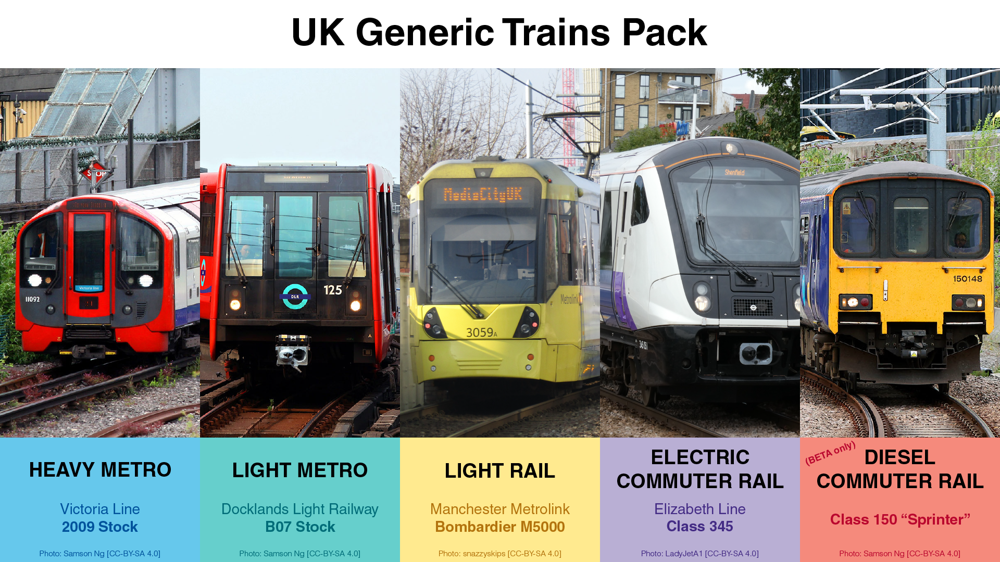
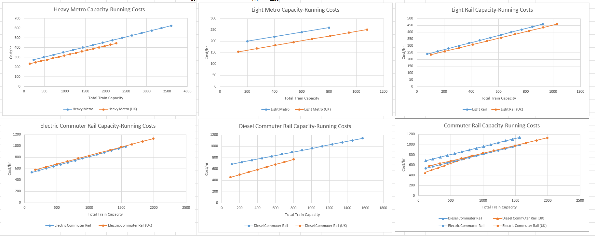
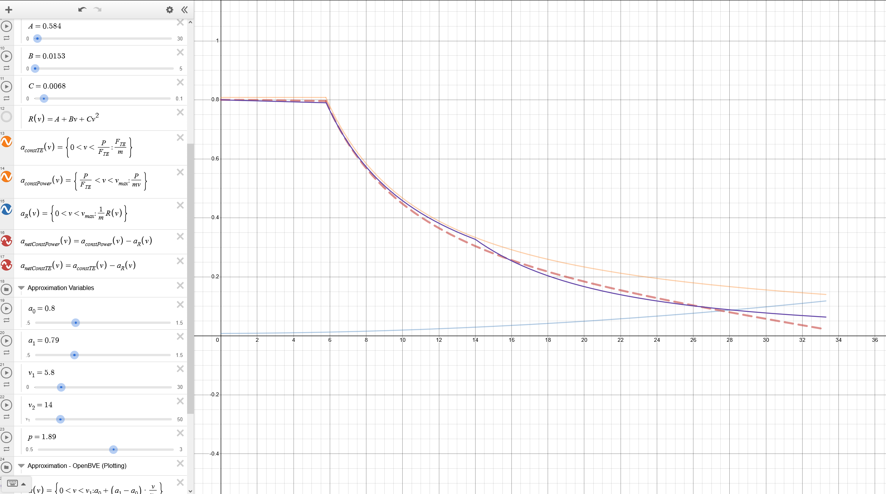

# Subway Builder UK Generic Trains Pack

> [!IMPORTANT]
> While the mod is fully supported in the current stable version of Subway Builder,
> certain features (and one train) included in this mod are only found in the **Beta build** of the game.

This mod replaces the base game trains with generic UK-inspired equivalents.



## Overview

What the mod's trains are based on:

- `heavy-metro`: 2009 Stock, London Underground Victoria Line
- `light-metro`: B07 Stock, Docklands Light Railway
- `light-rail`: Bombardier M5000, Manchester Metrolink
- `commuter-rail`: Class 345, Elizabeth Line
- [BETA only] `commuter-rail-diesel`: Very roughly a Sprinter, to be specific a Class 150

Empty cells indicate no changes made to base-game defaults. ▼ or ▲ are used where relevant to indicate whether important specifications are increased or decreased over base game trains.

|                                  | `heavy-metro` | `light-metro` | `light-rail` | `commuter-rail` | `commuter-rail-diesel` |
| -------------------------------- | ------------- | ------------- | ------------ | --------------- | ---------------------- |
| Car Length (m)                   | 16.6          | 14            | 14.4         | 22.7            | 19.9                   |
| Car Width (m)                    | 2.6           | 2.65          | 2.65         | 2.77            | 2.82                   |
| Capacity/car                     | 141           | 135           | 103          | 166             | 100                    |
| Seats/car                        | 32            | 28            | 30           | 50              | 70                     |
| Doors/car/side                   | 3             | 2             | 2            | 3               | 2                      |
| Min Cars                         | 4             | 2             | 2            | 4               | 2                      |
| Max Cars                         | 16            | 8             | 10           | 12              | 8                      |
| Cars/set                         | 1             | 2             | 2            | 1               | 2                      |
| Max speed (mph (kph))            | 50 (80) ▼     | 40 (64) ▼     | 50 (80) ▼    | 90 (145) ▲      | 75 (121) ▼             |
| Local Station speed (mph (kph))  | 30 (48)       | 25 (40)       | 25 (40)      | 90 (145)        | 75 (121)               |
| Crossover speed (mph (kph))      | 20 (32)       | 15 (24)       | 15 (24)      | 20 (32)         | 20 (32)                |
| Yard speed (mph (kph))           | 10 (16)       | 10 (16)       | 10 (16)      | 15 (24)         | 15 (24)                |
| Max Acceleration (m/s²)          | 1.3 ▲         | 1.4 ▲         | 1.08 ▼       | 1.0 ▲           | 0.8 ▲                  |
| Max Deceleration (m/s²)          | 1.14 ▲        | 0.8 ▼         | 1.03 ▼       | 0.9 ▼           | 0.6 ▼                  |
| Max Gradient (%)                 |               |               | 6.5          |                 |                        |
| Min Curve Radius (m)             |               |               | 15           |                 | 70                     |
| TPH Limit                        | 36 ▼          | 36 ▼          |              | 24 ▼            | 16 ▼                   |
| Parallel Track Spacing (m)       | 3.2           | 3.3           | 3.3          | 3.4             | 3.4                    |
| Track Clearance (m)              | 1             | 1.2           | 1.2          | 1.2             | 1.2                    |
| Car Cost ($M)                    | 1.5 ▼         | 1.2 ▼         | 1.6 ▼        | 5.5 ▲           | 2.7 ▼                  |
| Train Operating Cost/hr ($)      | 220 ▼         | 140 ▼         | 210 ▼        | 600 ▲           | 450 ▼                  |
| Car Operating Cost/hr ($)        | 14 ▼          | 14 ▼          | 25 ▲         | 63 ▲            | 50 ▲                   |
| Base Track Cost ($M)             | 29 ▼          | 27 ▼          |              |                 |                        |
| Base Station Cost ($M)           |               |               |              |                 | 48 ▼                   |
| Scissor Crossover Cost ($M)      |               |               |              |                 |                        |
| Track Operating Cost/m ($)       | 340 ▼         | 250 ▼         |              |                 | 270 ▼                  |
| Station Operating Cost/yr ($k)   | 300 ▼         |               |              |                 | 280 ▼                  |
| Level Crossing TPH Limit, Major  |               |               |              | 16 ▲            | 16 ▲                   |
| Level Crossing TPH Limit, Medium |               |               |              | 20 ▲            | 20 ▲                   |
| Level Crossing TPH Limit, Minor  |               |               |              | 20 ▲            | 20 ▲                   |

Some notes:

- All values not mentioned in the above table have not been modified.
- Track spacing/clearance: Main line (both commuter rail types) are derived from a 6 foot spacing between inner rails on parallel track (centreline distance is ~3.3 m), and 9 foot loading gauge width ([source](https://igg.org.uk/rail/2-track/02track3.htm)); Light Metro figures are from DLR track cross section documents; Others are estimated.
- Only max speeds can generally be found, the other speeds are estimates.

All specific sources are listed in the respective trains' sections.
In some cases, numbers are just lifted from Wikipedia, or are pure estimations (for parameters that expectedly are not public info).

### Beta Game Version Feature Support

- Diesel Commuter Rail: **Yes**, see _Trains in Detail/[BETA only] Diesel Commuter Rail_
- Tram: **No**.
- Acceleration Curves: **Yes**, see _Design Choices/Acceleration Curves_
- Multiple-track compatibility: Follows base game (diesel commuter trains can run on commuter rail)
- All other beta features (track cant, detailed track compatibility and inter-running, etc.): **No**, game will load base game defaults.

### Savegame Compatibility

This mod is fully compatible with existing saves that use base game trains. Even though track spacings are different, Subway Builder preserves distances between built tracks, even on double and quad segments. The only thing that will change is your rolling stock, which will require a fair bit of reconfiguring.

## Design Choices

### Choosing What to use for Light Metro, Light Rail, and Tram

There are many overlaps between transit systems in the UK that could be considered _Light Metro_, _Light Rail_, and _Tram_.

As _Tram_ is a beta train type that has to be separately enabled, and lacking a proper real-life reference, the likelihood of it coming to the base game seems rather low, and as such it is not included in this mod.

- While the DLR could be considered by some as _Light Rail_, it isn't really a _Light Rail_ system in the North American definition that Subway Builder is based on, so _Light Metro_ it is.
- It could be argued that something like the Tyne and Wear Metro is more fitting of the _Light Rail_ moniker (it is indeed a lighter rapid transit system that can have at-grade road crossings), but in the abscence of a proper tram type, I decide to substitute _Light Rail_ with one of the UK's tram+light rail systems, in this case Manchester Metrolink.

### Costs



Operating costs for trains are set predominantly based on passenger capacities, then adjusted according to top speed. Additional considerations used in setting these costs are elaborated further in the trains' respective sections.

Capital (purchase) costs for train cars are roughly set by considering the ratios of passenger capacity and top speed to the base game equivalents. The price difference is then reduced slightly to account for fixed costs, and/or tweaked for other reasons, such as acceleration capability.

- This is except for _Light Rail_, which has cars that cost way too much in the base game.

Infrastructure costs generally remain untouched, except for:

- _Diesel Commuter Rail_: Slightly decreased operating costs to account for lower intensity.
- _Heavy Metro_: Slightly decreased costs to account for small tunnels.
- _Light Metro_: Moderately decreased costs to account for lower performance.

### Acceleration Curves

Acceleration curves are derived based on initial acceleration, power, and an estimation of the resistive force on the train.

<details>

<summary>In Detail</summary>

A simplified model is used to first approximate the velocity-acceleration profile of each rail vehicle:

Acceleration in the initial constant tractive effort regime:

```math
a_{constTE}(v) = \frac{F_{TE}}{m}
```

Acceleration under constant power:

```math
a_{constPower}(v) = \frac{P}{mv}
```

Resistance as defined by the Davis Equation, using British Rail coefficients as derived by Armstrong and Swift in 1990 [1]. Exact coefficient calculation is not described here but can be found in `./scripts/calculate_davis_eqn_coeffs.py`.

```math
R(v) = A + Bv + Cv^2
```

The net velocity-acceleration profile is then:

```math
a_{net}(v) = \min\left[a_{constTE}(v), a_{constPower}(v) \right] - R(v)
```

The acceleration curve parameters (based on [OpenBVE](https://openbve-project.net/documentation/HTML/train_train_dat.html#acceleration)) for Subway Builder, (`a0`, `a`, `v1`, `v2`, `exponent`) are then tweaked manually until this new curve roughly lines up visually with the original approximation.



Example of a plot with the approximate acceleration, resistive force, net acceleration, and emulation curves.

Note that while this is probably an alright approximation for the trains that use electric motors. For the diesel-hydraulic Class 150, however, it likely is not. (There is a description of its TE curve [here](https://web.archive.org/web/20221205004502/https://www.railtechnical.com/br-class-150), only textual, the image links are dead.)

Sources:

1. B P Rochard, F Schmid. A review of methods to measure and calculate train resistances. 2000.

</details>

## Trains in Detail

### Heavy Metro

The London Underground's 2009 Stock, as used on the Victoria line. These are the most modern trains (_until whenever the 2024 Stock enters service_) in service on the London Underground, and most importantly allow for the highest modelled train frequency of 36 tph [1].
Using the S Stock from the subsurface lines was considered, but IMO using small deep-level tube trains is just more uniquely British.

Compared to the base game _Heavy Metro_, this UK version is distinct in having significantly smaller cars. But apart from a much lower maximum total capacity, they are balanced similarly to the base game.

Notes regarding implemented specifications:

- 4 doors/car/side: 2 double doors and 2 single doors per side on intermediate cars, the single doors are counted equally as the same doors.

Sources:

1. [Victoria line celebrates 50 years of serving London](https://tfl.gov.uk/info-for/media/press-releases/2018/august/victoria-line-celebrates-50-years-of-serving-london). 2018. TfL.
2. [Rolling Stock Information Sheets](https://www.whatdotheyknow.com/request/239641/response/590412/attach/3/RS%20Info%20Sheets%204%20Edition.pdf). 2014. London Underground.

### Light Metro

Rather than using the newer B23 stock from the DLR, I have elected to use the B07 stock instead.
The B23 stock are only available in 86 metre-long permanently-coupled 5-car sets, which are less flexible from a gameplay perspective compared to prior DLR rolling stock (including the B07 stock here), which run as 2-car coupled units.

Unlike the base game _Light Metro_, these are less suitable as simply lower-capacity/cost replacements for a heavy metro system, due to their poor top operating speed of 40 mph (64 kph). This however translates to even lower operating costs, stacking onto already-low operating costs due to automation.

Notes regarding implemented specifications:

- TPH limit is set to not exceed _Heavy Metro_.
- Track spacing: From [2], centreline spacing between parallel tracks varies between 3.1 to 4.1 m.

Sources:

1. [FOI request detail: Requesting for technical data of DLR](https://tfl.gov.uk/corporate/transparency/freedom-of-information/foi-request-detail?referenceId=FOI-2110-1718). 2018.
2. [FOI request detail: Technical drawings](https://tfl.gov.uk/corporate/transparency/freedom-of-information/foi-request-detail?referenceId=FOI-4241-2324). 2024.
   - STOCK (B2007) VEHICLE LAYOUT, Drawing Number 17016-DLR-RSK-B2007_Z-DR-K-0001. 2021.
   - TYPICAL TRACK CROSS SECTIONS, Drawing Number 53516-MTE-1207-C. 1987

### Light Rail

The Manchester Metrolink was chosen over other UK systems simply because it's by far the largest such network in the UK, both in terms of ridership and network size. It also does have the most... "Light Rail" vibe, being, IMO, most akin to a German Stadtbahn. Plus it has high platforms, and not to mention that station underneath Manchester Piccadilly.

Sources:

1. [FLEXITY Swift - Manchester, United Kingdom](https://web.archive.org/web/20120306013710/https://www.flexity2.bombardier.com/pdf/en/Manchester_10474_0209_en.pdf). 2012. Bombardier Transportation.

### (Electric) Commuter Rail

While notionally based on the Class 345 of the Elizabeth Line (_it's the most highly marketable one after all_), this implementation seeks to generally represent a modern high-intensity commuter train, like you would find across London and the Southeast, which includes the Elizabeth Line but also the London Overground and Thameslink, as well as other operators' suburban commuter system. Maximum performance is pegged against the Elizabeth Line.

The main downside of this implementation of _(Electric) Commuter Rail_ however, is that it is not representative of rail commuter systems outside London and the South, that operate under less intense requirements (much more seating, for instance). _Ideally, there would be an "Metro-like Heavy Rail" type that S-Bahns, the RER, equivalent East Asian systems, and the Elizabeth line slot into. But without that, Commuter Rail will just have to do._

Compared to base game _(Electric) Commuter Rail_, these trains offer a more intense version of commuter rail with: higher acceleration, higher capacities, with a higher top speed to boot. This shows in the noticeably higher operating costs of these trains.

Notes regarding implemented specifications:

- 24 TPH is the current maximum peak-hour frequency in the central Elizabeth Line core [1]. I can't find any material regarding whether the true maximum is higher. It likely is, but based on the phrasing in various sources, 24 TPH does seem to the current designed goal of the system.
- 1 m/s² acceleration [3]; 0.9 m/s² deceleration - pure guess

Sources:

1. [More frequent trains and new journey options mark one year of Elizabeth line operation](https://tfl-newsroom.prgloo.com/news/more-frequent-trains-and-new-journey-options-mark-one-year-of-elizabeth-line-operation). 2023. TfL.
2. [Class 345 Stock Information Sheet](https://foi.tfl.gov.uk/FOI-0416-2223/Class%20345%20Data%20Sheet%20ver%203.pdf). TfL.
3. [Crossrail rolling stock contract invitations to negotiate issued](https://web.archive.org/web/20241201210758/https://www.railwaygazette.com/crossrail-rolling-stock-contract-invitations-to-negotiate-issued/36709.article). 2012. Railway Gazette International.
4. [Layout Drawing: Unit Diagram (Full Length Unit, Class 345)](https://www.whatdotheyknow.com/request/469455/response/1126934/attach/3/Q234%20BMB%20R1%20XMO%20CR001%2050011%20Rev%203.0.pdf). Bombardier Transportation. 2018. Document 3EER400017-0764, Revision F.

### [BETA only] Diesel Commuter Rail

> [!IMPORTANT]
> This mod **overrides** the base game `commuter-rail-diesel` train id.
> As such, it will not be loaded if you are playing in a non-beta game version that does not have the base game train type included. It will fail silently and log a warning, but nothing breaks.

As implemented in the mod, _Diesel Commuter Rail_ is _meant_ to represent the kinds of cheaper, unelectrified, low-capacity local trains that still somewhat serve a commuter role, that you can find across the UK. Something that just a few decades ago would be home to a _Pacer_.
While in the present day, these lines are increasingly run by their larger Super/Express Sprinter brethren (or a Class 195/196/197 Civity), I am using a regular class 150 here because their 75 mph top speeds are more fitting for what this should represent. But otherwise, apart from the larger physical sizes (and costs etc.) associated with those longer-distance-oriented models, other parameters such as seat count are roughly similar.

As such, out of all the implemented trains, it deviates the most from its base game equivalent. While that is a large loco-hauled commuter trainset with very poor acceleration, this is a lightweight DMU with merely satisfactory acceleration. While per-train operating costs are significantly decreased, per-car operating cars are high to account for individual diesel motors and transmissions under each DMU car.

Notes regarding implemented specifications:

- Sprinters and Sprinter-like trains generally have 65-75 seats per car, with maximum standing capacity not something that is typically reported.
- 0.8 m/s² max acceleration is for the Class 158 [2]

Sources:

1. [Vehicle Diagram Book No. 220 for Diesel Multiple Unit Trains (Railcars)](https://web.archive.org/web/20150121172516/http://barrowmoremrg.co.uk/BRBDocuments/Book220Issue.pdf). 1988. Derby: Mechanical & Electrical Engineering Department, British Railways Board.
2. [Class 158](https://web.archive.org/web/20210806025938/https://eversholtrail.co.uk/fleet/class-158-freight-same-category/). Archived 2021. Eversholt Rail Limited.
